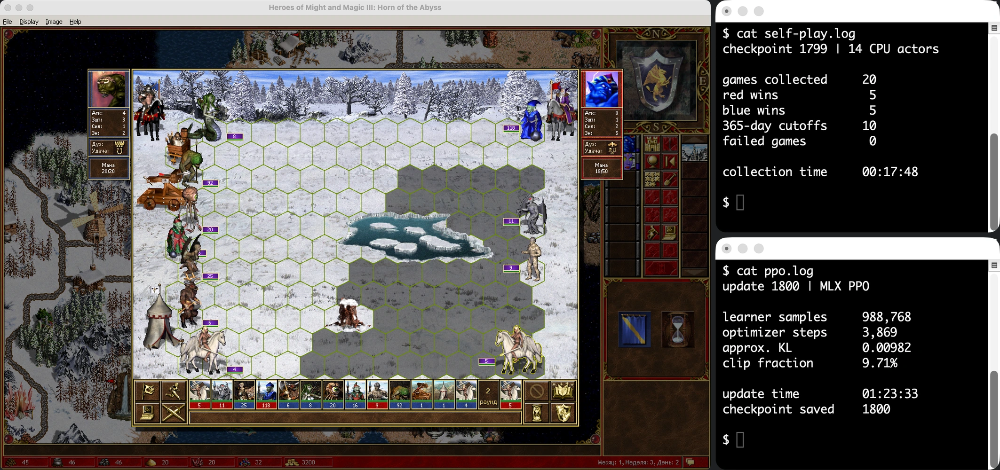

# Heroes RL

Can a policy learn to take an enemy town in *Heroes of Might and Magic III*? It has to recruit an army, choose a route through fog of war and keep pursuing its objective across turns. Heroes RL studies those decisions by putting a recurrent policy in control of both players on a VCMI adventure map.



*On the left, a player’s Horn of the Abyss battle. On the right, two Terminal windows summarize the recorded training run from checkpoint 1799 to 1800. During self-play, VCMI’s BattleAI handles tactical combat.* [Run record](docs/research-log.md#2026-11-21--one-20-game-update-from-checkpoint-1799)

## What has the policy learned?

In a head-to-head evaluation, two frozen policies played **ten fresh seeds twice**, swapping Red and Blue on each seed. Both played the same scenario, with learning switched off. The engine recorded who owned each town after every transfer.

| Across 20 games | Checkpoint 1797 | Checkpoint 1793 |
| --- | ---: | ---: |
| Games won | 8 | 5 |
| Games in which it captured the enemy home town | 9 | 5 |
| Stalled approaches followed by a capture within seven days | 1 of 13 | 0 of 22 |

Seven games reached the 365-day limit. The most revealing moment came one tile from a town. The attacking hero ran out of movement, then headed elsewhere the next day. A teammate captured the town three days later. Across all 35 stalled approaches, the same hero never explicitly targeted that town again on the following day. Checkpoint 1797 led on wins in this sample. Sustaining an attack across turns remains an open problem. [Results by seed](docs/research-log.md#paired-evaluation-results) · [Attack traces and scoring](docs/research-log.md#attack-follow-through)

## How self-play works

1. **Observe.** Each seat receives its own visible map, heroes, armies, resources and currently available actions from the engine. A recurrent network carries information from one decision to the next.
2. **Act.** The policy chooses where to move, what to recruit or build, how to arrange armies and when to end the turn. The engine reports whether it accepted the action.
3. **Learn.** Up to 14 CPU actors collect games with the same frozen weights. Once the requested batch is complete, PPO updates the network using MLX on Apple silicon. A checkpoint saves the weights, Adam optimizer, shuffle state and counters together.

The published **checkpoint 1800** records **10,402 self-play games** and **23,338,478 learner decisions** across its training history. Its final batch contained 20 games and 988,768 training samples. The current experiments use one authored adventure map. Playing strength on other maps is still unmeasured. [Download checkpoint 1800](checkpoints/update-001800.pt) · [Architecture](docs/architecture.md) · [Scenario and action restrictions](docs/temporary-restrictions.md)

## Run it

On a configured training machine with an initialized state, these commands inspect the current checkpoint and then collect 20 usable games for one PPO update.

```sh
./train.command check
./train.command 20
```

For a new checkout, the training guide covers building the patched engine, supplying your own game data, and starting from the published checkpoint or random weights. [Training guide](docs/training.md) · [Research journal](docs/research-log.md) · [Third-party notices](THIRD_PARTY_NOTICES.md)
